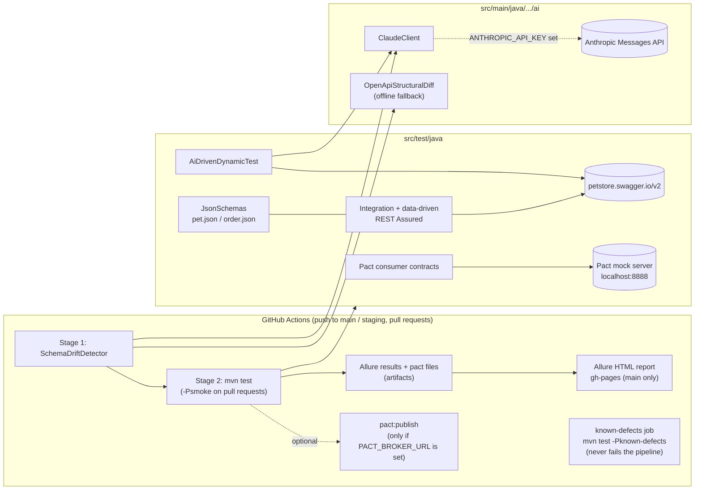

# REST Assured + Pact + AI API Test Blueprint

[](https://github.com/maneesh96/rest-assured-ai-pact-blueprint/actions/workflows/ci-pipeline.yml)
[](https://maneesh96.github.io/rest-assured-ai-pact-blueprint/)

A Java 17 / Maven API test framework for the public
[Swagger Petstore](https://petstore.swagger.io/v2). It combines REST Assured integration
tests, Pact consumer contracts, JSON-schema validation, an OpenAPI drift check and an
optional Claude-backed test generator, and it keeps spec violations the live API
does not meet in a separate, clearly labelled known-defect set instead of asserting
them as passing.

The latest Allure report from `main` is published at
**https://maneesh96.github.io/rest-assured-ai-pact-blueprint/**.

## Architecture



Both AI features work without an API key: `ClaudeClient` reports itself as not
configured and the callers switch to their offline paths (a fixed set of adversarial
payloads for the generator, a rule-based structural diff for drift detection), so a
fresh clone and pull requests from forks build without secrets.

## Test layers

Counts are from the latest `main` pipeline run (141 tests, all passing). The 15
known-defect cases are excluded from that run and listed separately below.

| Layer | Where | Tag(s) | Tests | What it checks |
| --- | --- | --- | --- | --- |
| Contract | `contract/PetStoreConsumerContractTest` | `contract` | 3 | Pact V3 consumer contracts for `GET /v2/pet/{id}` and `POST /v2/pet`, matched by type against a local Pact mock server; pact files land in `target/pacts`. |
| Integration | `integration/PetStoreIntegrationTest` | `regression` (5 methods also `smoke`) | 28 | Chained create / read / update / delete flows for pets, orders and users against the live petstore. Each test creates its own data through `PetStoreFixture`, so the order they run in does not matter. |
| Data-driven | `integration/PetStoreDdtTest` | `regression` | 59 | `@ParameterizedTest` boundary and validation cases for the pet, store and user endpoints. |
| AI-generated | `ai/AiDrivenDynamicTest` | `regression` | 6 | `@TestFactory` cases for `POST /pet`, generated by Claude from the OpenAPI spec when `ANTHROPIC_API_KEY` is set, otherwise from the offline set. |
| Schema drift | `ai/OpenApiStructuralDiffTest` | `smoke`, `regression` | 16 | Offline structural diff of two OpenAPI specs: removed paths or operations, newly required request fields, removed response fields and changed types, using the fixtures in `src/test/resources/drift/`. |
| Unit (offline) | `ai/ClaudeClientTest`, `support/JsonSchemasTest` | `smoke`, `regression` | 29 | Model resolution order, markdown-fence stripping and the not-configured case in `ClaudeClient`; the Pet and Order JSON schemas accept valid and reject invalid documents. |

Every live response for Pet and Order is also validated against the JSON schemas in
`src/test/resources/schemas/json/`. The shared request spec in `ApiConfig` logs the
full exchange only when a validation fails, so passing runs stay quiet; the Allure
REST Assured filter still attaches every request and response to the report.

## Running it

Requirements: Java 17 and Maven 3.9+. The integration and data-driven layers call
`https://petstore.swagger.io/v2`, so they need network access to it.

| Command | Runs |
| --- | --- |
| `mvn test` | Every layer except `known-defect` (what CI runs on `main` and `staging`) |
| `mvn test -Psmoke` | Offline unit tests plus the five critical-path integration tests (what CI runs on pull requests) |
| `mvn test -Pregression` | Integration, data-driven, AI-generated and unit tests, without the Pact contracts |
| `mvn test -Pcontract` | Pact consumer contracts only; writes `target/pacts` |
| `mvn test -Pknown-defects` | Only the known-defect tests; they are expected to fail |
| `mvn allure:serve` | Builds and opens the Allure report from `target/allure-results` |

### Claude (optional)

```bash
export ANTHROPIC_API_KEY=...          # enables the Claude paths
export ANTHROPIC_MODEL=claude-sonnet-4-6   # optional override
```

The model is resolved in this order: the `ANTHROPIC_MODEL` environment variable, then
`anthropic.model` in `src/test/resources/test-env.properties`, then the default in
`ClaudeClient`. Without a key, nothing calls the Anthropic API.

### Schema drift check

```bash
mvn compile exec:java -Dexec.mainClass="com.api.blueprint.ai.SchemaDriftDetector" \
    -Dexec.args="src/test/resources/schemas/petstore-openapi.yaml path/to/current-openapi.yaml"
```

The first argument is the baseline spec and the second the spec to check. Any breaking
change exits with status 1 and prints the list. In CI the step runs with the defaults,
and because no `petstore-openapi-current.yaml` is committed there is nothing to compare
yet, so it passes without checking anything. To make it a real gate, fetch the
provider's current spec into that path before the step runs.

### CI secrets

All optional. Without them the pipeline still runs and stays green.

| Secret | Effect |
| --- | --- |
| `ANTHROPIC_API_KEY` | Switches the generator and drift check from offline to Claude |
| `PACT_BROKER_URL`, `PACT_BROKER_TOKEN` | Publishes the pact files to a Pact Broker after a green run |

## Known defects

The live petstore accepts several inputs its own OpenAPI spec forbids (for example a
pet with no `name`, an order with a negative `quantity`, or an invalid `status` enum),
and returns 500 for two malformed bodies. The tests for these assert the correct
response (400), are tagged `known-defect` and run in their own CI job, which lists the
defects that still reproduce and flags any that start passing. The full list, with
expected and actual status codes, is in [KNOWN_DEFECTS.md](KNOWN_DEFECTS.md).

## Project layout

```
.github/
  workflows/ci-pipeline.yml        drift check, tests, artifacts, Allure to gh-pages, known-defects job
  scripts/report_known_defects.py  job summary for the known-defects job
src/main/java/com/api/blueprint/
  ai/        ClaudeClient, SchemaDriftDetector, OpenApiStructuralDiff
  config/    ApiConfig (base URI, REST Assured and Allure filter setup)
  models/    Pet, Order, User, Category, Tag, ApiResponse (Jackson POJOs)
src/test/java/com/api/blueprint/
  ai/           AiDrivenDynamicTest, ClaudeClientTest, OpenApiStructuralDiffTest
  contract/     PetStoreConsumerContractTest
  integration/  PetStoreIntegrationTest, PetStoreDdtTest, support/PetStoreFixture
  support/      TestTags, JsonSchemas, JsonSchemasTest
src/test/resources/
  schemas/petstore-openapi.yaml    baseline spec
  schemas/json/                    Pet and Order JSON schemas
  drift/                           baseline / breaking / compatible spec fixtures
  test-env.properties              base URL, Pact names, Claude model
KNOWN_DEFECTS.md
```

## Stack

Java 17, Maven, JUnit 5.10, REST Assured 5.4 (with `json-schema-validator`),
Pact JVM 4.6, Jackson 2.16, SnakeYAML 2.2, Allure 2.25, GitHub Actions and GitHub Pages.
